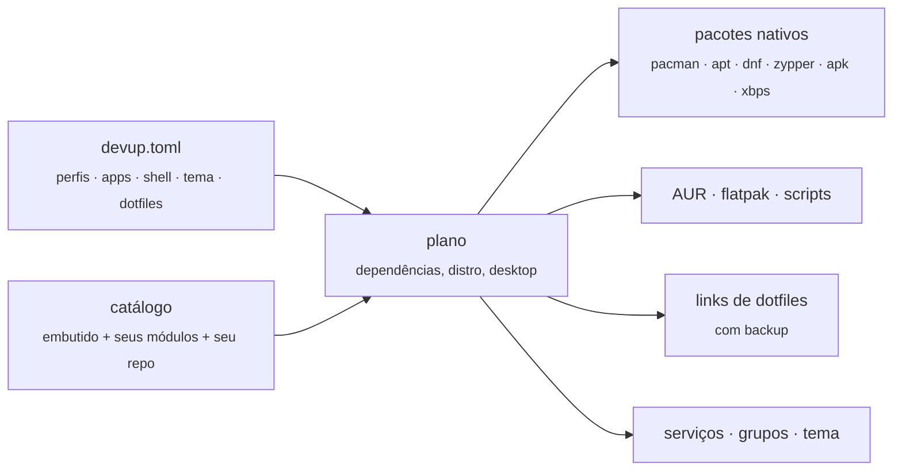
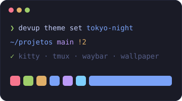
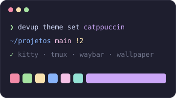
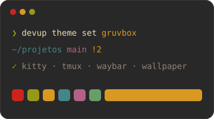
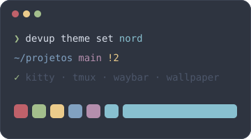

<p align="center">
  
</p>

<p align="center">
  <a href="https://github.com/bernardofernandezz/devup/releases/latest"></a>
  <a href="https://github.com/bernardofernandezz/devup/actions/workflows/release.yml"></a>
  
  
</p>

<p align="center">
  <b>Formatou o PC? Trocou de distro? Uma linha e sua máquina volta a ser sua.</b><br>
  Apps de dev, jogos e uso geral, dotfiles, shell, tema e desktop, descritos num arquivo e aplicados em <i>qualquer</i> distro.
</p>

---

```sh
curl -fsSL https://raw.githubusercontent.com/bernardofernandezz/devup/main/install.sh | sh
devup init
```

O `init` olha a máquina antes de perguntar: distro, desktop, shell, o que já está instalado e as linguagens que você usa. Depois faz poucas perguntas, todas já respondidas com a recomendação e o motivo, e mostra o plano antes de mexer em qualquer coisa:

```
devup  Arch Linux · pacman · hyprland · shell bash

✔ Para que você usa este computador? · Programar, Jogar, Apps do dia a dia
✔ Quais linguagens? · JavaScript / Node, Rust
✔ Editor? · Neovim + VS Code
✔ Qual shell? · zsh
✔ Qual tema? · nord

Plano
  instalar     9  steam, lutris, heroic, firefox, spotify, zsh +3
  já tem      16  git, neovim, docker, lazygit, cli-tools, btop +10
  pular        3  gnome, kde, niri  (não se aplicam aqui)
  configs      5  arquivos linkados · 1 para backup: ~/.zshrc
  shell           bash → zsh
  tema            nord

? Tudo certo? ›  Aplicar · Ajustar apps · Cancelar
```

Com um setup já existente, o init pergunta só o que você quer mudar. `devup init --yes` aceita as recomendações sem perguntar nada.

## Por que

- **Uma distro não te prende.** O mesmo `devup.toml` funciona em Arch, Debian, Ubuntu, Fedora, openSUSE, Alpine, Void e derivadas.
- **Declarativo e reproduzível.** Seu setup é um arquivo de 5 linhas. `devup apply --from <url>` replica tudo num PC novo.
- **Nada é apagado.** Toda config substituída vai para um backup, e `devup restore` desfaz.
- **Linguagens das fontes oficiais.** Node, Rust, Go, Bun, Deno, Python, Java, .NET e mais, baixadas de nodejs.org, rustup.rs, go.dev etc., com o checksum do projeto conferido.
- **Entende a máquina.** Distro, desktop, placa de vídeo, notebook, WSL e o que você já tem instalado (inclusive via mise, nvm ou asdf).
- **Um binário, zero dependências.** Estático, cerca de 7 MB, sem runtime. Se atualiza sozinho com verificação e rollback.

## Como funciona



Para cada app, o devup tenta o **pacote nativo** da distro, depois **AUR** (se houver paru/yay), depois **flatpak** e por fim um **script** oficial. Os pacotes vão numa única chamada ao gerenciador. Se um nome não existir na sua versão da distro, só ele falha e o resto é instalado.

## O seu setup

Fica em `~/.config/devup/devup.toml`:

```toml
profiles = ["dev", "gaming"]
modules  = ["obsidian", "spotify"]
exclude  = ["vscode"]                      # não instala, mesmo vindo de um perfil
shell    = "zsh"
theme    = "tokyo-night"
dotfiles = ["https://github.com/<você>/dotfiles"]
```

| Comando | O que faz |
|---|---|
| `devup` / `devup init [-y]` | Entende a máquina, recomenda, mostra o plano e aplica |
| `devup apply` | Deixa a máquina igual ao `devup.toml` |
| `devup apply --from <arquivo\|url>` | Usa o setup de outra máquina (validado antes de salvar) |
| `devup add <app\|perfil>…` | Adiciona e aplica |
| `devup remove <app\|perfil>…` | Tira do arquivo (não desinstala) |
| `devup status` | ✓ instalado · ✗ falta · - não se aplica aqui |
| `devup shell zsh\|fish\|bash` | Define o shell padrão |
| `devup theme list` / `set <nome>` | Lista e troca o tema |
| `devup dotfiles add <url>` / `sync` | Seu repo de dotfiles |
| `devup restore [id]` | Devolve os arquivos que o devup substituiu |
| `devup lang add\|use\|remove\|list\|update` | Linguagens das fontes oficiais |
| `devup env` | O que o devup detectou: hardware, sessão, linguagens no PATH e de onde vêm |
| `devup doctor` | Diagnóstico do que está ok e do que corrigir |
| `devup update [--check\|--rollback]` | Baixa, confere o checksum e troca o binário; `--rollback` volta |
| `devup list [--category] [--profile]` | O catálogo e como cada app seria instalado aqui |
| `devup install <app\|perfil>…` | Instala sem mexer no `devup.toml` |
| `devup completions bash\|zsh\|fish` | Autocomplete |

Todo comando que muda a máquina mostra o plano antes e pergunta uma vez, como o `terraform apply`. Sem o argumento, `add`, `install`, `remove`, `theme set`, `shell` e `restore` abrem um seletor. Um nome errado vira sugestão: `devup install dokcer` → *você quis dizer docker?*

## Saída e opções

Durante a instalação aparece uma linha por etapa, no estilo do cargo. A saída do gerenciador de pacotes vai para um log e só reaparece se algo falhar:

```
  Atualizando [1/4] índice de pacotes 3.1s
   Instalando [2/4] 9 pacotes (pacman) 41.7s
   Instalando [3/4] 3 apps (flatpak) 1m02s
     Linkando [4/4] 5 configs · 1 para backup
✓ Pronto em 1m48s · 12 pacotes · 5 configs
→ Abra um novo terminal para usar o zsh
```

| Opção | O que faz |
|---|---|
| `-y`, `--yes` | Aplica sem perguntar. Em scripts (sem terminal), é obrigatório |
| `--dry-run` | Mostra o plano e os comandos, sem executar nem salvar nada |
| `-v`, `--verbose` | Mostra a saída completa de cada comando |
| `-q`, `--quiet` | Só erros e o resumo final |
| `--color auto\|always\|never` | Cores; `NO_COLOR` também é respeitado |
| `--json` | Em `list`, `status`, `doctor` e `theme list`, para scripts |

- **sudo:** pedido uma vez, antes de começar, dizendo para que será usado.
- **Logs:** cada execução fica em `~/.local/state/devup/logs/`.
- **Códigos de saída:** 0 ok, 1 falha, 2 uso incorreto (ou falta `-y` sem terminal), 130 cancelado.
- **Autocomplete:** `source <(devup completions zsh)` (ou `bash`, ou `fish`). As configs de shell do devup já fazem isso.
- **Aviso de versão nova:** verificado no máximo uma vez por dia, em segundo plano. `DEVUP_NO_UPDATE_CHECK=1` desliga.
- **Animações:** abertura e spinners com as cores do tema; somem em CI, sem terminal, com `-q`, `NO_COLOR` ou `DEVUP_NO_ANIMATION=1`.
- **API do GitHub:** com `GITHUB_TOKEN` definido, as consultas usam o token e não esbarram no limite de 60 por hora.

## O que vem no catálogo

| Perfil | Módulos |
|---|---|
| `dev` | git, neovim, docker, lazygit, cli-tools (ripgrep, fzf, fd, bat, zoxide), btop, mise, tmux, starship, vscode |
| `gaming` | steam, lutris, heroic, protonup-qt, gamemode, mangohud, discord |
| `essentials` | firefox, obsidian, spotify, vlc, libreoffice |
| `server` | git, neovim, cli-tools, btop, docker |
| `desktop` | fonts + a config do desktop que estiver rodando |
| `full` | dev + gaming + essentials |

Também avulsos: nodejs, rustup, ghostty, kitty, chromium, obs e os shells. Veja todos com `devup list`.

### Linguagens

```sh
devup lang add node go bun          # versões padrão (lts / latest)
devup lang add node@22 java@21 rust@nightly python@3.12
devup lang use node@20              # troca a versão em uso
devup lang list                     # o que existe, o que está instalado e de onde vem
devup lang update                   # versões novas do que está no devup.toml
```

| Linguagem | Fonte oficial | Versões |
|---|---|---|
| Node.js | nodejs.org | `lts`, `latest`, `22`, `22.11.0` |
| Bun | github.com/oven-sh/bun | `latest`, `1.4.4` |
| Deno | github.com/denoland/deno | `latest`, `2.9.8` |
| Rust | rustup.rs | `stable`, `beta`, `nightly`, `1.89.0` |
| Go | go.dev | `latest`, `1.27`, `1.27.3` |
| Zig | ziglang.org | `latest`, `0.17.0` |
| Python | astral.sh (uv) | `3.13`, `3.12` |
| Java (Temurin) | adoptium.net | `lts`, `latest`, `21` |
| .NET | dot.net | `lts`, `latest`, `10.0` |
| Flutter | flutter.dev | `stable`, `beta`, `3.47.9` |
| Kotlin | github.com/JetBrains/kotlin | `latest`, `2.4.21` |

- **Checksum:** cada download é conferido com o que o projeto publica. Se a conexão cai, o download continua de onde parou, e o cache em `~/.cache/devup` deixa reinstalar sem rede.
- **Build certo para a máquina:** x86_64/aarch64 e glibc/musl, escolhidos sozinhos.
- **Bibliotecas do sistema:** se faltar alguma (`libatomic`, ICU…), o devup instala pela distro e testa de novo.
- **Onde fica:** as versões ficam em `~/.local/share/devup/toolchains`, e os comandos entram no PATH pelo `~/.local/share/devup/env.sh`, que as configs de shell do devup já carregam.

### Shell

`devup shell zsh` (ou `fish`, ou `bash`) instala o shell com starship, zoxide e fzf, linka a config e o torna o shell padrão. Os três carregam os mesmos aliases (`g`, `gs`, `lg`, `v`, `dc`…). Suas customizações vão em `~/.config/devup/shell/local.sh` (ou `local.fish`), que o devup nunca toca.

### Temas

<table>
  <tr>
    <td align="center"><br><code>tokyo-night</code></td>
    <td align="center"><br><code>catppuccin</code></td>
    <td align="center"><br><code>gruvbox</code></td>
    <td align="center"><br><code>nord</code></td>
  </tr>
</table>

`devup theme set nord` muda as cores de kitty, ghostty, tmux, waybar e das bordas do Hyprland, além do wallpaper (Hyprland, Niri, GNOME e KDE) e da cor de destaque do GNOME. Tudo é recarregado na hora.

Cada tema é só uma paleta. Para criar o seu, copie um arquivo de [`catalog/themes/`](catalog/themes) para `~/.config/devup/themes/<nome>.toml` e troque as cores.

### Desktop

`devup add desktop` detecta o ambiente (`XDG_CURRENT_DESKTOP`) e aplica só o que corresponde:

| Desktop | O que muda |
|---|---|
| GNOME | Tema escuro, 6 workspaces fixos, Super+1..6, Super+Q fecha, Super+Enter abre o terminal |
| KDE Plasma | Tema escuro, 6 áreas de trabalho, Meta+1..6, Meta+Q fecha |
| Hyprland | Config completa com waybar, fuzzel, mako, hyprlock e hypridle |
| Niri | Config completa com waybar, fuzzel, mako e swaylock |
| qualquer um | JetBrainsMono Nerd Font + emoji |

Se outra ferramenta já gerencia o Hyprland na máquina, o módulo se mantém de fora.

### Dotfiles

Vem com configs prontas para tmux, starship, kitty e ghostty. Para usar as suas:

```sh
devup dotfiles add https://github.com/<você>/dotfiles
```

O repo pode estar no **formato stow** (`zsh/.zshrc` vira `~/.zshrc`) ou trazer **módulos próprios** em `devup/*.toml`. Tudo vira symlink, e o que existia antes vai para `~/.local/state/devup/backups/`.

## Seus módulos

Crie `~/.config/devup/modules/*.toml`. Um módulo com o nome de um embutido o substitui.

```toml
[profile.meu-setup]
description = "Meu setup"
include = ["dev"]
modules = ["docker", "obsidian"]

[[module]]
name = "docker"
category = "dev"            # dev | games | general | server | shell | desktop | theme | dotfiles
description = "Containers"
requires = ["git"]          # instalados antes
pacman = "docker docker-compose"
apt = "docker.io"
dnf = "moby-engine"
zypper = "docker"
apk = "docker"
xbps = "docker"
aur = "..."                 # se houver paru/yay
flatpak = "..."             # fallback
script = "curl ... | sh"    # último recurso
bin = "docker"              # se já estiver no PATH, pula a instalação
services = ["docker"]       # systemctl enable --now
groups = ["docker"]         # usermod -aG
files = [{ src = "docker/daemon.json", dest = "~/.config/docker/daemon.json" }]
run = ["echo pronto"]       # pós-instalação, idempotente
desktop = ["gnome"]         # só nesses desktops
skip_if = "[ -f /etc/x ]"   # pula se o comando der sucesso
```

## Distros

| Distro | Gerenciador | Extras |
|---|---|---|
| Arch, Manjaro, EndeavourOS… | `pacman` | AUR via paru/yay |
| Debian, Ubuntu, Mint, Pop!_OS… | `apt` | |
| Fedora, Nobara… | `dnf` | |
| openSUSE | `zypper` | |
| Alpine | `apk` | sem systemd: `services` são ignorados |
| Void | `xbps` | sem systemd: `services` são ignorados |
| qualquer outra | flatpak + scripts | |

Os nomes de pacotes do catálogo são conferidos nos repositórios reais de Arch, Ubuntu 24.04, Fedora 42, openSUSE Tumbleweed, Alpine 3.22 e Void.

## Desenvolvimento

```sh
cargo test                        # testes
cargo run -- --dry-run init       # experimente sem mudar nada
cargo run -- doctor
```

- **Código:** `src/` tem `catalog` (módulos, perfis, dependências), `plan` (o que executar), `pm` (distros), `config` (devup.toml), `dotfiles`, `theme` e `doctor`.
- **Catálogo:** `catalog/default.toml`, com as configs em `catalog/assets/` e os temas em `catalog/themes/`.

**Publicar uma versão:** adicione a seção no [`CHANGELOG.md`](CHANGELOG.md) e rode:

```sh
git tag v0.2.0 && git push origin v0.2.0
```

O workflow testa, gera binários estáticos para x86_64 e aarch64, publica o `sha256sums.txt` e usa a seção do CHANGELOG como notas do Release.
